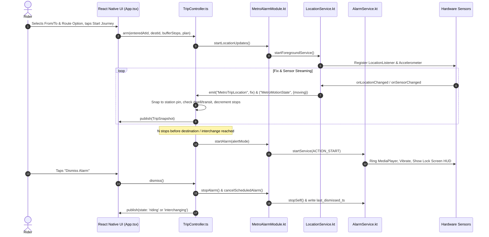

# Delhi Metro Alarm App · System Architecture

## 1. High-Level Overview

The Delhi Metro Alarm App is a resilient, 100% offline, privacy-first mobile application built with React Native and native Android (Kotlin) foreground services. Its core goal is to guarantee that transit riders sleeping or distracted on the Delhi Metro are awakened $N$ stops before their interchange or destination station—even when travelling deep in underground concrete tunnels with zero GPS, cellular data, or internet connectivity.

```
┌────────────────────────────────────────────────────────────────────────┐
│                        React Native UI Layer                           │
│  - App.tsx (Root View, Tab Navigation, Theme Engine)                  │
│  - SplashInputScreen (From/To selectors, Swap, Quick-Hubs, Test Mode)  │
│  - RouteOptionsSelector (Top 2 paths: Fastest vs Alternate Transfers)  │
│  - AlertModeSelector (Sound & Vibrate, Vibration Only, Silent Alert)   │
│  - TripScreen (Active ride HUD, countdown, underground delay controls) │
│  - PlannerScreen (Multi-criteria offline graph search)                 │
└───────────────────────────────────▲────────────────────────────────────┘
                                    │ Event Emitter & Bridge Calls
                                    ▼
┌────────────────────────────────────────────────────────────────────────┐
│               TypeScript Business Logic & State Machine                │
│  - TripController.ts (State machine: idle/riding/interchange/alarmed)  │
│  - planner.ts (Dijkstra fastest, BFS least changes, planAlternates)    │
│  - delhiNetwork.ts & data.ts (Bundled offline station topology & times)│
│  - MetroAlarm.ts (Typed JS wrapper for NativeModules.MetroAlarm)       │
└───────────────────────────────────▲────────────────────────────────────┘
                                    │ Android Native Bridge
                                    ▼
┌────────────────────────────────────────────────────────────────────────┐
│                     Android Native Platform Layer                      │
│  - MetroAlarmModule.kt (Native bridge, permission checks, storage)    │
│  - LocationService.kt (Foreground service: GPS + Accelerometer fusion) │
│  - AlarmService.kt (Foreground audio playback, vibration, wake-locks)  │
│  - AlarmActivity.kt (Full-screen lock screen dismissal HUD)           │
│  - AlarmReceiver.kt & BootReceiver.kt (AlarmManager hardware wakeups) │
└────────────────────────────────────────────────────────────────────────┘
```

---

## 2. Layered Sensor Fusion Architecture

Inside the Delhi Metro network, physical conditions transition between elevated viaducts (strong GPS) and subterranean tunnels (zero GPS). The architecture utilizes a tiered sensor fusion model:

```
                  ┌──────────────────────┐
                  │ Location / Sensors   │
                  └──────────┬───────────┘
                             │
            ┌────────────────┴────────────────┐
            ▼                                 ▼
   Above Ground (GPS)               Underground Tunnels
   - Accuracy < 80m                 - GPS Occluded (Fix loss > 40s)
   - Great-circle haversine snap    - 3-Axis Accelerometer (SensorManager)
   - Speed >= 2.0 m/s: transit      - Timetable inter-station runtimes
   - Speed < 1.5 m/s: platform      - Cell tower snap (expanded to 600m)
   - Double confirmation on alert   - Delay Hold toggle & manual calibration
```

### Component Breakdown

1. **`LocationService.kt` (Android Foreground Service)**:
   * Runs in the foreground with a persistent system notification (`FOREGROUND_SERVICE_LOCATION`).
   * Manages Android's native `LocationManager` (`GPS_PROVIDER` and `NETWORK_PROVIDER`).
   * Implements `SensorEventListener` on `Sensor.TYPE_ACCELEROMETER` without any external library. Computes dynamic motion delta against standard gravity ($9.8\text{ m/s}^2$) and emits `MetroMotionState` when train motion stops or starts.
   * Emits structured `MetroTripLocation` events to React Native containing `{ lat, lon, accuracy, speed, ts, moving }`.

2. **`TripController.ts` (Core State Engine)**:
   * Maintains journey state: `idle` $\rightarrow$ `riding` $\rightarrow$ `interchange_alarm` $\rightarrow$ `interchanging` $\rightarrow$ `alarmed` $\rightarrow$ `done` (or `wrong_trip` on error recovery).
   * Snaps fixes along the planned station pins using haversine spherical trigonometry.
   * Implements automatic platform dwell timers ($38\text{s}$) and dead-reckoning inter-station progression when underground.
   * Integrates user delay holds (`isTrainDelayed`) to freeze timetable countdowns during signal stalls.
   * Manages hardware alarm watchdogs via Android `AlarmManager`.

3. **`AlarmService.kt` (Audio & Vibration Execution Engine)**:
   * Uses `MediaPlayer` with `AudioAttributes.USAGE_ALARM` to bypass system Do Not Disturb and software volume attenuation.
   * Employs repetitive vibration patterns via `Vibrator` / `VibratorManager`.
   * Enforces a 60-second SharedPreferences dismissal guard window to suppress stray pending intents.
   * Launches `AlarmActivity.kt` over the Android lock screen with `FLAG_KEEP_SCREEN_ON` and `FLAG_SHOW_WHEN_LOCKED`.

---

## 3. Data Flow During An Active Journey



---

## 4. Resilience & Crash Recovery

1. **Hardware Watchdog Timers**:
   Whenever a station fix is confirmed, `TripController` calculates the estimated arrival time at the alarm station and schedules an Android `AlarmManager.setExactAndAllowWhileIdle()` wakeup. If the phone is placed into deep sleep (Android Doze) or React Native JavaScript execution is throttled, the native hardware RTC triggers `AlarmReceiver`, waking `AlarmService` independently.
2. **Double Confirmation Filtering**:
   GPS multipath reflection from urban overpasses can cause sudden jump fixes. The controller requires 2 consecutive valid confirmation fixes within the alarm zone before triggering audio, eliminating false alarms.
3. **Off-Route & Wrong Direction Recovery**:
   If the passenger mistakenly boards the wrong train (e.g. Yellow Line instead of Blue Line at Rajiv Chowk), the controller detects deviation beyond $700\text{m}$, identifies the current station on the global graph, and computes an instant offline Dijkstra recovery route.
